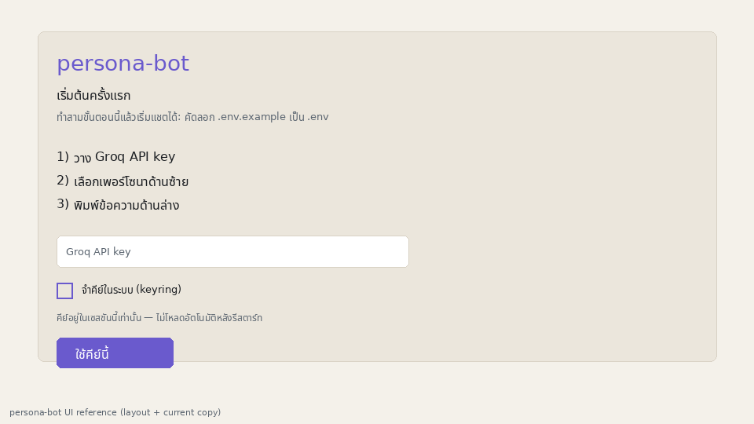
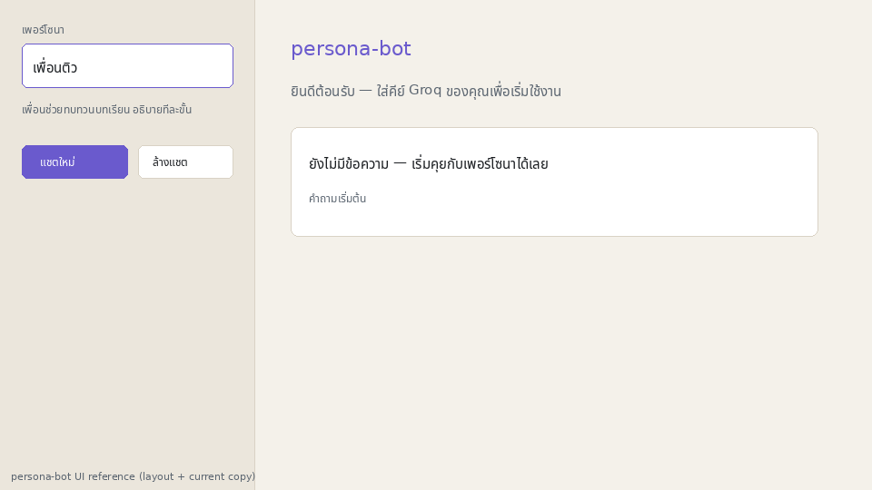
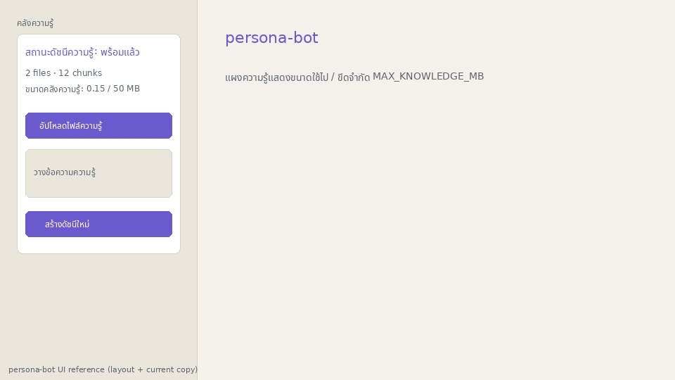
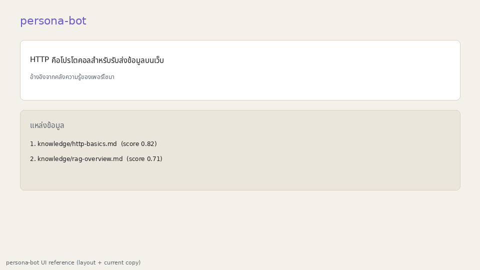
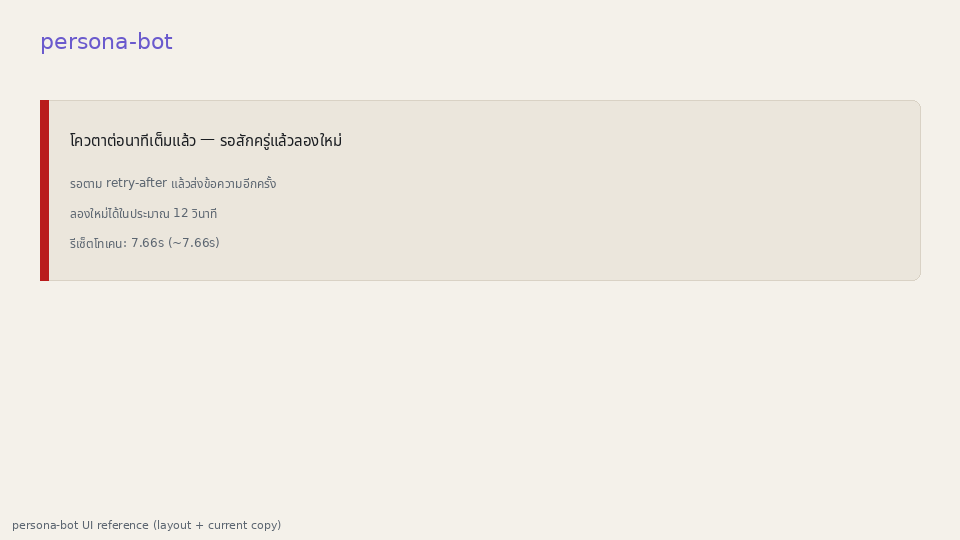

# persona-bot

แชตบอท AI ส่วนตัวที่รันฟรีบนเครื่องคุณ (BYOK ผ่าน Groq + embeddings แบบโลคอล)

Personal AI chatbot you can clone and run for free. Bring your own Groq API key;
embeddings run locally. Configure a **Persona Pack** (role + knowledge + tuning)
and chat in Thai UI.

## สำหรับคนทั่วไป / For everyone

1. **ติดตั้ง:** [Docker Desktop](https://www.docker.com/products/docker-desktop/) **หรือ** ดับเบิลคลิก `start.bat` (Windows) / `./start.sh` (macOS/Linux)
2. **คีย์ (แนะนำ):** สมัคร [Groq](https://console.groq.com/) ฟรี → วางคีย์ในช่อง UI (หรือใส่แค่ `GROQ_API_KEY` ใน `.env`) — **ไม่ต้องแก้ชื่อโมเดล** ค่าแนะนำมีใน `.env.example` แล้ว
3. **เริ่มคุย:** เลือกเพอร์โซนา (เช่น「โน้ตส่วนตัว」/ Personal notes หรือ「เพื่อนติว」) → ถามได้เลย  
   **ไม่มีคีย์?** กด「ใช้แบบคลังความรู้เท่านั้น」แล้ววางโน้ต → ถาม-ตอบจากคลัง (ไม่ใช้ AI ออนไลน์)

แถบภาพสั้น: คีย์ → เลือกเพอร์โซนา → ถาม — ดู [Screenshots](#ภาพหน้าจอ--screenshots) ด้านล่าง  
รายละเอียด: [docs/FIRST_RUN.md](docs/FIRST_RUN.md) · [docs/FAQ.md](docs/FAQ.md)

### นี่คืออะไร / ไม่ใช่อะไร — What this is / isn’t

| คือ / Is | ไม่ใช่ / Isn’t |
|---|---|
| รันบน**เครื่องคุณ** · เปิดใน**เบราว์เซอร์บนคอม** | แอปมือถือ / Line / แชตคลาวด์สาธารณะ |
| คีย์ **Groq ของคุณ** (BYOK) เมื่อต้องการ AI | SaaS ที่เก็บคีย์/แชตบนเซิร์ฟเวอร์ persona-bot |
| ความรู้ + แชตอยู่ใต้ `data/` โลคอล | ซิงค์ข้ามเครื่องอัตโนมัติ |
| ย้ายเครื่องด้วย **ส่งออก/นำเข้า zip** | พอร์ตเปิดให้มือถือบน LAN (ไม่แนะนำ — ความเป็นส่วนตัว) |

**ออฟไลน์ / โควตาหมด:** ดัชนีความรู้ (Chroma + fastembed) ทำงานโลคอลได้  
ถ้าไม่มีคีย์ / โทเคน Groq หมด / เน็ตล่ม แอปจะ**ตอบจากคลังความรู้**แบบอ้างข้อความ  
「ตอบจากคลังความรู้ (ไม่ใช้ AI ออนไลน์)」— **ไม่ใช่** คำตอบคุณภาพ ChatGPT ออฟไลน์

## Quick start — 3 วิธี / 3 ways

### 1) Windows (แนะนำสำหรับ DoD 1)

1. ติดตั้ง [Python 3.11+](https://www.python.org/downloads/) (ติ๊ก Add to PATH) **หรือ** ใช้ Docker ด้านล่าง
2. ดับเบิลคลิก `start.bat` (ติดตั้ง uv + sync + เปิด UI ให้)
3. คัดลอก `.env.example` → `.env` แล้วใส่แค่ `GROQ_API_KEY` (โมเดลมีค่าแนะนำแล้ว) — หรือวางคีย์ใน UI

PowerShell (ทางเลือก):

```powershell
irm https://astral.sh/uv/install.ps1 | iex
Copy-Item .env.example .env
# edit .env — set GROQ_API_KEY only (models are prefilled)
uv sync
uv run persona-bot
```

**Windows troubleshooting / แก้ปัญหา Windows**

| Issue | Fix |
|---|---|
| `uv` not found in a new terminal | `start.bat` patches PATH for that session (`%USERPROFILE%\.local\bin`). Open a **new** PowerShell or add that folder to User PATH permanently. |
| SmartScreen blocks `start.bat` | More info → Run anyway (unsigned local script). Or run the PowerShell steps above. |
| Path too long / extract errors | Enable **Win32 long paths**, or clone/extract closer to drive root (e.g. `C:\dev\PERSONAL-BOT`). |

รายละเอียดเพิ่ม: [docs/FIRST_RUN.md](docs/FIRST_RUN.md) · [docs/FAQ.md](docs/FAQ.md)

### 2) macOS / Linux (`uv`)

```bash
./start.sh
# or:
uv sync
cp -n .env.example .env
uv run persona-bot
```

### 3) Docker (แนะนำสำหรับคนที่ไม่คุ้น Python)

```bash
cp -n .env.example .env   # set GROQ_API_KEY locally — never commit
docker compose up --build
# open http://127.0.0.1:8501
```

โควตา/ลิมิตของ Groq ดูจากเอกสารทางการเท่านั้น — ห้ามใส่ตัวเลขโควตาตายตัวใน README  
See official Groq docs for free-tier limits:
https://console.groq.com/docs/rate-limits

UI ผูก **http://127.0.0.1:8501** (localhost เท่านั้น) — ดู [docs/FIRST_RUN.md](docs/FIRST_RUN.md)
สำหรับแคชโมเดล, การข้ามแบนเนอร์อีเมล Streamlit, และ first-run

## ภาพหน้าจอ / Screenshots

| Welcome | Persona | Knowledge |
|---|---|---|
|  |  |  |

| Sources | Error card (429) |
|---|---|
|  |  |

More context: [docs/GALLERY.md](docs/GALLERY.md)

## ปรับแต่งความรู้ / Customize knowledge

**ในแอป (แนะนำ):** เลือกเพอร์โซนา → แถบข้าง「คลังความรู้」/ Knowledge  
- กด **ทำสำเนา** ถ้าเป็นตัวอย่าง (ตัวอย่างอ่านอย่างเดียว)  
- สร้าง/แก้ชื่อ พรอมต์ระบบ โหมดคำตอบ (ตอบเฉพาะความรู้ / ยืดหยุ่น / สไตล์อิสระ)  
- อัปโหลด `.txt` `.md` `.pdf` `.docx` หรือวางข้อความ แล้วกด **บันทึกความรู้ให้พร้อมใช้** (สร้างดัชนีให้อัตโนมัติ)  
  สถานะไทย: **พร้อมแล้ว** / **ต้องสร้างดัชนีใหม่**  
- ค่าแล็บ (temperature / top_k / min_score / …) อยู่ใน「ขั้นสูง」

**In-app (recommended):** pick a persona → sidebar **Knowledge**  
- Click **Duplicate** for example packs (examples stay read-only)  
- Create/edit name, system prompt, answer mode (Knowledge only / Flexible / Free style)  
- Upload `.txt`/`.md`/`.pdf`/`.docx` or paste text, then **Save knowledge & make ready** (auto-rebuilds)  
  Status: **Ready** / **Rebuild the index**  
- Lab knobs live under **Advanced**

**เทมเพลตโน้ตส่วนตัว:** เลือก `personal-notes` /「โน้ตส่วนตัว」→ ทำสำเนา → วางโน้ต → พร้อมใช้  
**ทาง zip (หลายเครื่อง):** ส่งออก → นำเข้าบนเครื่องอื่น (เปลี่ยนชื่อถ้า id ซ้ำ) — ดู [docs/FAQ.md](docs/FAQ.md)

## ความต้องการ / Requirements

- Python **3.11–3.13** หรือ Docker
- [uv](https://docs.astral.sh/uv/) (ถ้าไม่ใช้ Docker)
- Groq API key สำหรับคำตอบแบบ AI (optional ถ้าใช้โหมดคลังความรู้เท่านั้น)

## โครงสร้างหลัก / Layout

- `persona_bot/` — application (chat UI + RAG)
- `personas/examples/` — example persona packs
- `data/` — runtime only (gitignored)
- `start.bat` / `start.command` / `start.sh` — one-click launchers
- `Dockerfile` / `docker-compose.yml` — localhost-only packaging

## พัฒนา / Development

```bash
uv sync --extra dev
uv run ruff check .
uv run ruff format .
uv run mypy
uv run pytest -m "not slow" --cov=persona_bot --cov-fail-under=60
uv run coverage report --rcfile=coverage.core.toml   # core ≥80% (omits Streamlit shell)
```

Owner-only live smoke (not CI): `uv run python scripts/smoke_test.py`  
Weekly canary (maintainer): `GET /models` only — see `.github/workflows/canary.yml`

Docs: [FAQ](docs/FAQ.md) · [Gallery](docs/GALLERY.md) · [First run](docs/FIRST_RUN.md) ·
[Design/a11y](docs/DESIGN.md) · [Contributing](CONTRIBUTING.md) · [Security](SECURITY.md) ·
[Third-party notices](THIRD_PARTY_NOTICES.md)

## ใบอนุญาต / License

MIT — see `LICENSE`. Third-party / model notices: [THIRD_PARTY_NOTICES.md](THIRD_PARTY_NOTICES.md).
